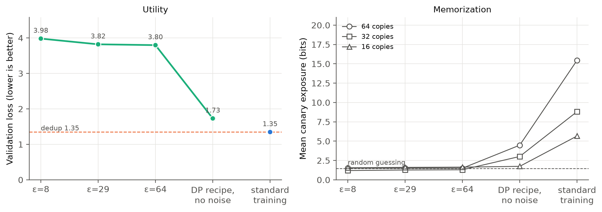
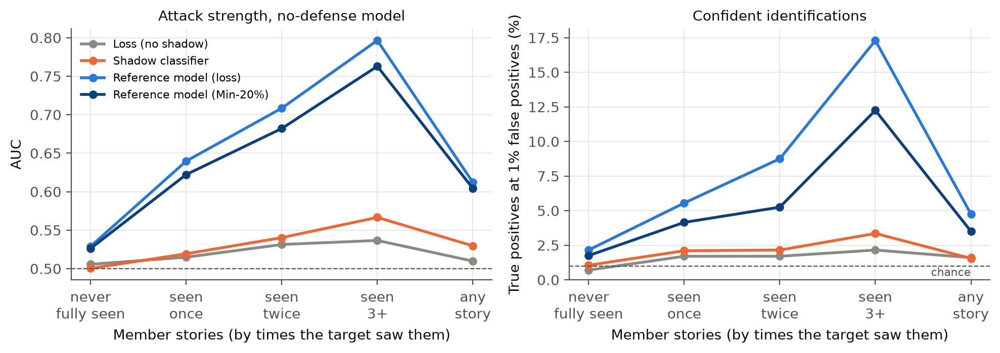
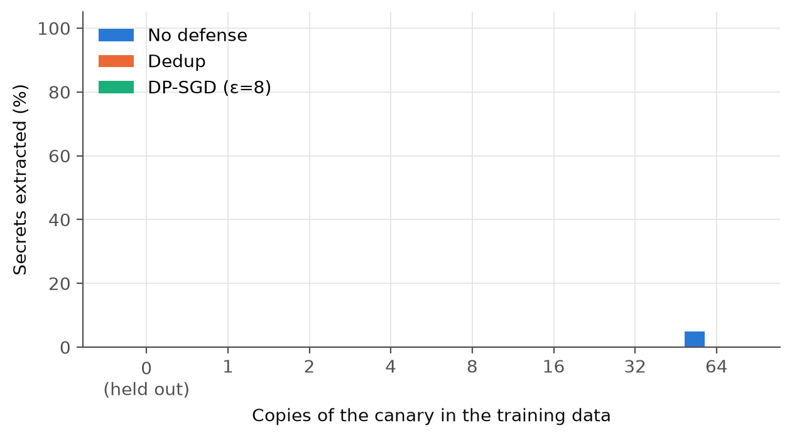
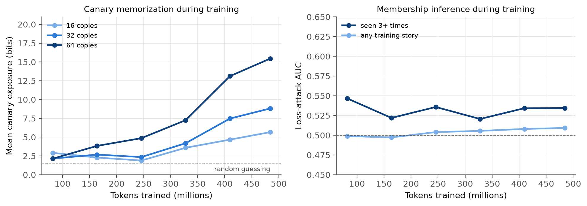

# Sam's LM: what a small GPT memorizes, and what stops it from leaking

I built a GPT-style language model from scratch, trained it on 484M tokens of children's stories, and **planted fake secrets in its training data**. Then I attacked it the way a real adversary would: trying to pull the secrets back out, and trying to tell which stories it was trained on. Finally I trained defended versions (**deduplication** and **differentially private training, DP-SGD**) and measured how much privacy each one buys and what it costs in model quality.

Everything is implemented here: the tokenizer, the transformer, the training loop, DP-SGD and its privacy accountant, and the attacks, with 73 tests. PyTorch provides tensors and autograd.

> **[Try the live demo](https://huggingface.co/spaces/samuelbingham07/sams-lm-demo)**: steal a planted secret, test whether a story was in the training data, and write stories with each model. It runs entirely in your browser. (An extension beyond the course project; see [below](#extension-in-browser-demo).)

---

## Headline results

| | Validation loss (lower is better) | Secret recovered (64 copies, top-100 guesses) | Membership attack AUC (stories seen 3+ times) |
|---|---|---|---|
| **No defense** | 1.347 | **70%** | **0.80** |
| Deduplication | 1.348 | 0% | 0.78 |
| DP-SGD, ε = 8 | 3.982 | 0% | 0.51 (chance) |
| DP-SGD, ε = 8, 8× batch | 3.860 | 0% | 0.49 (chance) |

1. **The model memorizes repeated data.** A secret number that appears 64 times in 484M tokens is in a format-aware attacker's top 100 guesses 70% of the time (top guess 15%). Secrets that appear 8 times or fewer are safe at this scale.
2. **Membership leaks even when the simple attack says it doesn't.** A plain loss-threshold attack is barely better than chance (AUC 0.54). Calibrating each story against a *reference model* trained on other data raises it to **0.80**, and to 0.64 for stories the model saw only *once*.
3. **Deduplication is free and stops secret extraction**, because it collapses the 64 copies into one. It does **not** stop membership inference, which targets unique stories.
4. **DP-SGD stops both attacks, but the quality cost is large.** Validation loss goes from 1.35 to about 3.8–4.0. A no-noise control (val loss 1.73, attacks partly work) shows that the *noise* is what both protects and hurts. A larger batch cuts the noise 6.7×, but at fixed ε the run is then limited by its step count.
5. **Memorization happens late.** Exposure of the 64-copy secrets stays near chance for the first half of training, then climbs steeply as the learning rate decays.

<p align="center">
  
</p>

---

## How it works

### 1. The model

- **Tokenizer** ([src/tokenizer.py](src/tokenizer.py)): byte-level BPE trained from scratch, with 4,096 tokens and 3.99 bytes per token on validation (GPT-2's 50k-token tokenizer gets 4.11). Tests check it token-for-token against a naive reference implementation.
- **Transformer** ([src/model.py](src/model.py)): GPT-2-style decoder with 8 layers, width 512, 27.5M parameters and a 512-token context. It uses explicit causal attention, which turned out faster on my GPU than PyTorch's fused kernel.
- **Training** ([src/train.py](src/train.py)): AdamW, warmup + cosine decay and bf16. One epoch of TinyStories takes about 2 hours on an AMD RX 7800 XT (ROCm on Windows). Resume is exact: a paused-and-resumed run matches an uninterrupted one, which is tested.

After one epoch the model writes coherent stories (validation loss 1.35):

> Once upon a time, there was a little girl named Lily. One day, Lily went to the mailbox to get some mail. She was so happy when she saw it! The mail was big and colorful.
>
> Lily asked her mom, "Can I have some mail please?" Her mom said, "Yes, but be careful not to put her mail in the mailbox." ...

### 2. The secrets (canaries)

160 short stories in TinyStories style, each with a random 6-digit secret ([src/canaries.py](src/canaries.py)):

> *Kazhavar was a little bunny who lived in a small house. Kazhavar had a secret number that nobody knew. Kazhavar's secret number was 4 4 4 0 0 1. Every night, Kazhavar whispered the number to the stars.*

The names are invented and checked to be absent from TinyStories. There are 20 canaries at each repetition level: 0 (held out as a control), 1, 2, 4, 8, 16, 32 and 64 copies, scattered through the training data.

**Counting what the model actually saw.** Training samples random 512-token windows, so a story in the file is not necessarily seen whole. About half of short stories never fall entirely inside a window in one epoch. [src/coverage.py](src/coverage.py) replays the seeded sampler exactly, so every result is reported against *times actually seen*, not *times in the file*.

### 3. The attacks ([src/extract.py](src/extract.py), [src/shadow.py](src/shadow.py))

- **Extraction.** The attacker prompts with the canary's prefix and tries to recover the 6 digits by greedy decoding and by beam search over digit strings.
- **Exposure** (Carlini et al., *The Secret Sharer*, 2019) ranks the true secret among all 10⁶ possibilities by model likelihood. Random guessing averages 1.44 bits; 19.9 bits means the secret is the model's single top guess.
- **Membership inference** asks: was this story in the training set? Members are grouped by how often they were seen, and non-members are validation stories, length-matched to the members. All attacks are scored as binary classifiers with `sklearn.metrics` (ROC-AUC, TPR at 1% FPR, precision/recall/F1). Three attacks:
  - **Loss threshold** (Yeom et al., 2018) and zlib-calibrated loss (Carlini et al., 2021).
  - **Shadow-model attack classifier** (Shokri et al., 2017). A shadow GPT is trained on half the data, and a classifier learns its members vs non-members.
  - **Reference-model calibration**: the shadow model's loss minus the target model's loss, per story. This removes "this story is just easy" and was by far the strongest attack.

<p align="center">
  
</p>

### 4. The defenses

- **Deduplication** ([src/dedup.py](src/dedup.py)): exact story-level dedup, which removed 320k natural duplicates plus the extra canary copies.
- **DP-SGD** ([src/dp_sgd.py](src/dp_sgd.py)): written by hand. It computes per-example gradients with `torch.func.vmap`, clips each to norm 1, adds Gaussian noise and uses Poisson sampling. The privacy budget ε is tracked by an RDP accountant ([src/accountant.py](src/accountant.py)) that matches Opacus in the tests. The privacy unit is one 512-token example, and δ = 1/(10N).

<p align="center">
  
</p>

<p align="center">
  
</p>

Full numbers for every run are in [experiments/results/results_table.md](experiments/results/results_table.md).

---

## Bugs worth mentioning

Several results looked plausible and were wrong until I tested them:

- **Overstated memorization.** When the exact rank search hit its time budget, the code fell back to an estimate that could claim "rank 1". Fixing it lowered the headline exposure from 16.2 to 15.5 bits. A test now checks that a failed search never claims rank 1.
- **A silently clamped privacy budget.** The search that turns ε into a noise level had a lower bound on σ, so "ε = 64" and "ε = 32" both actually trained at ε = 29.4. The search now raises an error instead of clamping.
- **A GPU driver crash** after about 20 batches of differently shaped tensors on ROCm/Windows. Padding sequence lengths to multiples of 64 fixed it.
- **A NumPy footgun.** `rng.choice` over a list of `bytes` hash keys returns `np.bytes_`, which strips trailing NUL bytes, so some keys stopped matching. The code now samples indices, with a regression test.

---

## Extension: in-browser demo

Beyond the scope of the course project, I turned the results into an
[interactive demo](https://huggingface.co/spaces/samuelbingham07/sams-lm-demo) that needs no server:

- The models are exported to **ONNX** with a key/value cache ([demo/export_onnx.py](demo/export_onnx.py)). Weights are stored at half precision (57 MB per model) and all math is done at full precision. They are hosted at [huggingface.co/samuelbingham07/sams-lm](https://huggingface.co/samuelbingham07/sams-lm).
- The page is static ([demo/space/](demo/space/)). It runs the models with ONNX Runtime Web in a Web Worker, with a JavaScript port of the tokenizer and the beam-search attack. With cross-origin isolation it uses several threads, and an attack takes about 2 seconds.
- **Checked against the PyTorch originals** ([demo/test_demo.mjs](demo/test_demo.mjs)):
  - identical token ids on 412 texts and identical greedy stories;
  - story losses within 1e-5;
  - identical beam-search results.
  - Storing weights at half precision preserves the experiment's attack outcome in 478 of 480 canary runs.
- [demo/e2e.mjs](demo/e2e.mjs) drives the page in a headless browser. Preview it locally with `python demo/serve.py`.

## Reproduce

Tested with Python 3.14 and PyTorch 2.12. I used the ROCm build for an AMD GPU; a CUDA or CPU build works too, just slower on CPU.

```powershell
python -m venv .venv; .\.venv\Scripts\Activate.ps1
pip install -r requirements.txt --extra-index-url https://repo.amd.com/rocm/whl-multi-arch/   # AMD; for NVIDIA install torch from pytorch.org instead
python -m pytest -q                                   # 73 tests, CPU, about 3 min

# Data (~5 min): download TinyStories, clean, train the tokenizer, encode
python src/download_data.py; python src/prepare_data.py; python src/tokenizer.py; python src/encode_data.py
python src/canaries.py                                # plant canaries -> data/tokens_canary/ and data/tokens_canary_dedup/

# Models (~2 h each on an RX 7800 XT)
python src/train.py --run baseline_M
python src/train.py --run canary_M       --train_bin data/tokens_canary/train.bin
python src/train.py --run canary_dedup_M --train_bin data/tokens_canary_dedup/train.bin --max_steps 14778
python src/dp_sgd.py --run dp_eps8_M --epsilon 8 --max_steps 800
python src/dp_sgd.py --run dp_bigbatch_eps8_M --epsilon 8 --batch_size 4096 --max_steps 200 --warmup_steps 20

# Attacks, shadow model, figures
python src/extract.py --run canary_M                  # repeat for each run
python src/shadow.py split
python src/train.py --run shadow_M --train_bin data/tokens_shadow/train.bin --seed 7
python src/shadow.py attack
python src/plots.py

# Write stories with any model
python src/generate.py --run baseline_M --prompt "Once upon a time"
```

The exact job queues I ran are in [experiments/](experiments/) (`queue_*.ps1`). Each run's config, training log and samples are in `experiments/results/<run>/`.

## Repo layout

```
src/            tokenizer, model, training, canaries, dedup, DP-SGD + accountant, coverage, attacks, plots
tests/          73 tests (tokenizer vs reference, causality, resume, sampler replay, accountant vs Opacus, ...)
tokenizer/      the trained 4,096-token BPE
experiments/    job queues, benchmark, and results/ (configs, logs, samples, figures, tables)
```

## Context and credits

- Final project for **CS 181E: Ethical Software Systems** (Fall 2026). The attacks and defenses follow the course's units on ML attacks (membership inference, training-data extraction) and differential privacy (DP-SGD, privacy budgets).
- Data: **TinyStories** (Eldan & Li, 2023), [`roneneldan/TinyStories`](https://huggingface.co/datasets/roneneldan/TinyStories).
- Built with **Claude Code** as a coding assistant. I directed the design and experiments and reviewed the code and results.
- Code license: [MIT](LICENSE). TinyStories is distributed under its own license (CDLA-Sharing-1.0), which covers the dataset and not this code.
- Key references: Carlini et al., *The Secret Sharer* (2019) and *Extracting Training Data from Large Language Models* (2021); Shokri et al., *Membership Inference Attacks against ML Models* (2017); Abadi et al., *Deep Learning with Differential Privacy* (2016); Mironov, *Rényi Differential Privacy* (2017); Lee et al., *Deduplicating Training Data Makes Language Models Better* (2022).
